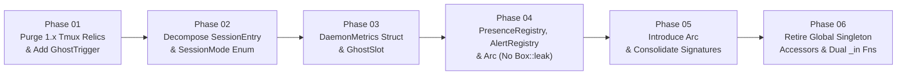

# Consolidate Daemon State & Finish the 2.0 Cleanup

**Status:** proposed design & implementation plan, drafted 2026-11-18.
**Written against:** `master` @ `db091473` (`v2.10.0`, post-M38 close, 287 Rust files in `src/`, 176,630 total LOC).
**Goal:** Raise DaemonEye's **State & Dependency Architecture** from **C+ to B** by (1) collapsing the 42 process-global atomics and caches in `src/daemon/stats.rs` into an injectable `DaemonMetrics` value, (2) purging dead 1.x tmux execution relics (`BgWindowInfo`, `bg_windows`, `ghost_bg_prefix`), (3) decomposing the 29-field `SessionEntry` god-struct into cohesive sub-structs and a `SessionMode::{Interactive, Ghost}` sum type, and (4) bundling the daemon's fragmented singletons and 4-to-7-argument handler signatures into `Arc<DaemonState>`.

---

## 1. Motivation & Problem Statement

Between `v2.0.0` (M20–M27) and `v2.10.0` (M38), DaemonEye replaced its tmux execution substrate with detached PTY `shell-host` processes, added a unified `Run`/`Turn` telemetry model, and routed all internal notifications through a journal-first `Bus`. However, four structural artifacts from the 1.x-to-2.0 transition remain in the tree and create friction in every new milestone:

### 1.1 Pervasive process-global singletons & `Box::leak` test workarounds
The daemon's runtime state is split between values passed explicitly as parameters (`sessions: SessionStore`, `cache: Arc<SessionCache>`, `schedule_store: Arc<ScheduleStore>`, `config: &Config`) and values reached through process-wide `OnceLock` singletons:
- `crate::bus::global()` (`src/bus/mod.rs:270`)
- `crate::shell::registry()` (`src/shell/mod.rs:68`)
- `crate::webhook::registry()` (`src/webhook/active.rs:58`)
- `crate::daemon::session::presence_registry()` (`src/daemon/session.rs:177`)
- `crate::config::current()` (`src/config/handle.rs:34`)
- 42 separate `static AtomicUsize` / `Mutex` variables in `src/daemon/stats.rs:18-65, 300-305, 484`

Because these singletons are process-global while `cargo test` runs tests in parallel on shared threads:
1. **Tests must leak memory to get `&'static Bus` references:** `WebhookState` holds `pub bus: &'static crate::bus::Bus`, so `notice_sinks::test_bus` (`src/daemon/notice_sinks.rs:301`), `server/notices.rs:87,132`, and `webhook/trigger.rs` call `Box::leak(Box::new(Bus::with_journal(|_| {})))`.
2. **Sinks bypass injected state:** Even when a test creates an isolated `test_bus`, `record_alert_registry` (`src/daemon/notice_sinks.rs:252-259`) reaches out to the process-global `crate::webhook::registry()` and `presence_broadcast_frame`, forcing the doc comment to warn: *"The registry is process-global: tests need a fingerprint no other test uses."*
3. **Dual `foo` / `foo_in` APIs proliferate:** `counters_tick_with_global`, `presence_push_to_session_in`, `apply_notice_to_registry_in`, `replay_alert_registry_in`, `list_shells_in`, `read_shell_in`, and `find_in_shells_in` exist solely because production code calls global singletons while tests must pass explicit references.

### 1.2 `stats.rs` has 42 independent global statics
`src/daemon/stats.rs` declares 39 `static AtomicUsize` counters, `NEXT_CMD_ID: AtomicUsize`, `RECENT_COMMANDS: Mutex<VecDeque<RecentCommand>>`, and `COST_TODAY_CACHE: Mutex<Option<CostTodayCacheEntry>>`, exposed through ~70 free `inc_*` / `get_*` functions.
- Tests for `GhostSlot` (`src/daemon/stats.rs:753-772`) cannot assert against `GHOSTS_ACTIVE` or `GHOSTS_COMPLETED` because parallel tests mutate the same global atomics; instead, `GhostSlot` carries a `fn(GhostEnd)` function pointer and a `thread_local! { static RELEASES }` workaround.
- `handle_status` (`src/daemon/server/handlers.rs:317-365`) makes 25 separate `get_*()` calls to assemble a single `Response::StatusReport`.

### 1.3 `SessionEntry` is a 29-field flat struct with illegal state combinations
`SessionEntry` (`src/daemon/session.rs:23-122`) stores interactive chat state, autonomous ghost state, token-compaction state, named-session persistence, and USD cost ledgers in a single flat struct:
- When `is_ghost == true`, interactive fields (`chat_pane`, `default_target_pane`, `tmux_session`, `last_detach`, `detach_time_utc`, `messages_at_detach`, `last_snapshot_activity`, `auto_name_suggested`, `saved_name`) are meaningless.
- When `is_ghost == false`, ghost fields (`ghost_config`, `ghost_runbook_name`, `ghost_bg_prefix`, `ghost_task_message`) are meaningless.
- Because `ghost_config` is `Option<GhostConfig>` alongside `is_ghost: bool`, the compiler cannot enforce that a ghost session has a config. `execute_tool_call` (`src/daemon/executor/mod.rs:479-492`) and `CostAttribution::from_ghost_config` (`src/cost.rs:65-75`) must carry defensive runtime fallback branches for `is_ghost && ghost_config.is_none()`.
- Fifteen test and production sites construct `SessionEntry` via 29-field struct literals, repeating 20+ dummy default fields every time.

### 1.4 Lingering 1.x tmux background-window relics
Although `v2.0.0` removed tmux command execution and `tests/tmux_read_only.rs` forbids any tmux write verb in `src/`:
- `pub struct BgWindowInfo` and `pub bg_windows: Vec<BgWindowInfo>` still sit on `SessionEntry` (`src/daemon/session.rs:10-34`). **Nothing in the entire crate ever pushes to or reads `bg_windows`**—all 19 references across `src/` are `bg_windows: Vec::new()` or `bg_windows: vec![]` in struct literals.
- `pub ghost_bg_prefix: &'static str` on `SessionEntry` (`src/daemon/session.rs:60`) and the `bg_prefix: &'static str` parameter on `GhostManager::start_session` / `start_session_with_config` (`src/daemon/ghost.rs:216,241`) pass `"de-gs-bg-"` (`GS_BG_WINDOW_PREFIX`) or `"de-gs-sj-"` (`GS_SCHED_WINDOW_PREFIX`) even though ghosts never create tmux windows. Its sole consumer is `ghost_run_kind` (`src/daemon/ghost.rs:367-371`), which string-compares `bg_prefix == GS_SCHED_WINDOW_PREFIX` to decide whether the run trigger was `"scheduled"` or `"webhook"`.

---

## 2. Scope & Non-Goals

This plan covers **Stage 1 (C+ → B)**. The following items belong to **Stage 2 (B → A)** and are deliberately out of scope here so each milestone stays small and behavior-preserving:

- **Not in this plan (Stage 2):** Replacing ambient `$HOME` lookups (`std::env::var("HOME")`) with an injected `RuntimeTree` and deleting `TEST_HOME_LOCK` / `REAL_HOME`.
- **Not in this plan (Stage 2):** Moving `ai::CIRCUIT_BREAKER`, `HTTP_CLIENT`, and `STREAM_TIMEOUTS` into a per-provider `AiGateway`.
- **Not in this plan (Stage 2):** Refactoring `PendingCall` (`src/ai/types/pending.rs`) into a `{ id, thought_signature, kind: ToolCallKind }` envelope.
- **Not in this plan:** Removing the read-only tmux observer (`src/tmux/`) or the `de-*` window-name predicates (`is_daemon_window`, `is_ghost_window` in `src/daemon/mod.rs:50-90`) used by `src/tmux/cache.rs` and `daemoneye schedule windows` to filter legacy windows.

---

## 3. Design Decisions

### D1 — Collapse `src/daemon/stats.rs` into `DaemonMetrics`

Replace the 42 module-level `static` variables in `src/daemon/stats.rs` with a single `DaemonMetrics` struct composed of domain sub-structs:

```rust
#[derive(Default)]
pub struct DaemonMetrics {
    pub commands: CommandCounters,
    pub approvals: ApprovalCounters,
    pub artifacts: ArtifactCounters,
    pub memory_prompt: MemoryPromptCounters,
    pub ghosts: GhostCounters,
    pub compactions: CompactionCounters,
    pub webhooks: WebhookCounters,
    next_cmd_id: AtomicUsize,
    recent_commands: Mutex<VecDeque<RecentCommand>>,
    cost_today_cache: Mutex<Option<CostTodayCacheEntry>>,
}
```

#### Sub-struct layout
- **`CommandCounters`**: `fg_succeeded`, `fg_failed`, `bg_succeeded`, `bg_failed`, `sched_succeeded`, `sched_failed` (`AtomicUsize`).
- **`ApprovalCounters`**: `commands_fg_approved`, `commands_fg_denied`, `commands_bg_approved`, `commands_bg_denied`, `scripts_approved`, `scripts_denied`, `runbooks_approved`, `runbooks_denied`, `file_edits_approved`, `file_edits_denied` (`AtomicUsize`).
- **`ArtifactCounters`**: `runbooks_created`, `runbooks_executed`, `runbooks_deleted`, `scripts_created`, `scripts_executed`, `scripts_deleted`, `memories_created`, `memories_recalled`, `memories_deleted`, `schedules_created`, `schedules_executed`, `schedules_deleted` (`AtomicUsize`).
- **`MemoryPromptCounters`**: `stable_block_rebuilds`, `dynamic_block_empty_turns`, `memories_in_stable_block`, `memories_in_dynamic_block_avg`, `memories_pinned`, `memories_unpinned` (`AtomicUsize`).
- **`GhostCounters`**: `launched`, `active`, `completed`, `failed` (`AtomicUsize`).
- **`CompactionCounters`**: `count`, `msgs_in`, `msgs_out` (`AtomicUsize`), plus `pub fn ratio(&self) -> f64`.
- **`WebhookCounters`**: `received`, `rejected` (`AtomicUsize`).

#### `GhostSlot` holds `Arc<DaemonMetrics>`
Instead of a `fn(GhostEnd)` pointer and thread-local test vecs, `GhostSlot` holds `Option<Arc<DaemonMetrics>>`:

```rust
pub struct GhostSlot {
    metrics: Option<Arc<DaemonMetrics>>,
}

impl GhostSlot {
    pub fn claim(metrics: Arc<DaemonMetrics>) -> Self {
        metrics.ghosts.inc_launched(); // increments both launched and active
        Self { metrics: Some(metrics) }
    }

    pub fn finish(mut self, end: GhostEnd) {
        if let Some(m) = self.metrics.take() {
            m.ghosts.release(end);
        }
    }
}

impl Drop for GhostSlot {
    fn drop(&mut self) {
        if let Some(m) = self.metrics.take() {
            m.ghosts.release(GhostEnd::Failed);
        }
    }
}
```

A unit test simply creates `let m = Arc::new(DaemonMetrics::new());`, claims a `GhostSlot::claim(m.clone())`, and asserts directly on `m.ghosts.active()`, `m.ghosts.completed()`, and `m.ghosts.failed()` with zero cross-test interference.

---

### D2 — Purge 1.x Tmux Execution Relics & Introduce `GhostTrigger`

1. **Delete `BgWindowInfo` and `SessionEntry.bg_windows`** (`src/daemon/session.rs:9-19, 34`):
   - Remove `pub struct BgWindowInfo` and the `bg_windows` field from `SessionEntry` and all 19 struct-literal initializers.
2. **Replace `ghost_bg_prefix: &'static str` with `GhostTrigger`**:
   - Define `GhostTrigger` in `src/daemon/ghost.rs` (re-exported from `src/daemon/mod.rs`):
     ```rust
     #[derive(Debug, Clone, Copy, PartialEq, Eq, serde::Serialize, serde::Deserialize)]
     #[serde(rename_all = "lowercase")]
     pub enum GhostTrigger {
         Webhook,
         Scheduled,
         Interactive,
         Delegated,
     }

     impl GhostTrigger {
         pub fn as_str(self) -> &'static str {
             match self {
                 GhostTrigger::Webhook => "webhook",
                 GhostTrigger::Scheduled => "scheduled",
                 GhostTrigger::Interactive => "interactive",
                 GhostTrigger::Delegated => "delegated",
             }
         }
     }
     ```
   - Update `GhostManager::start_session` and `GhostManager::start_session_with_config` (`src/daemon/ghost.rs:212-243`) to take `trigger: GhostTrigger` instead of `bg_prefix: &'static str`:
     - `src/webhook/process.rs:539` passes `GhostTrigger::Webhook`.
     - `src/daemon/scheduled.rs:350` passes `GhostTrigger::Scheduled`.
     - `src/daemon/executor/knowledge/ghost.rs:153` (`spawn_ghost_shell`) passes `GhostTrigger::Delegated` when `is_ghost` is true, or `GhostTrigger::Interactive` when spawned from chat.
     - `src/daemon/server/handlers.rs:624` (`handle_resume_run`) passes `GhostTrigger::Interactive`.
   - Update `ghost_run_kind` (`src/daemon/ghost.rs:353-376`) to take `trigger: GhostTrigger` instead of `bg_prefix: &str`, eliminating the `bg_prefix == GS_SCHED_WINDOW_PREFIX` string comparison.
   - Keep `BG_WINDOW_PREFIX`, `SCHED_WINDOW_PREFIX`, `GS_BG_WINDOW_PREFIX`, `GS_SCHED_WINDOW_PREFIX`, and `INCIDENT_WINDOW_PREFIX` in `src/daemon/mod.rs` **private to `is_daemon_window` and `is_ghost_window`** (for the read-only tmux observer and `daemoneye schedule windows`).
3. **Rename `src/daemon/executor/foreground.rs` → `src/daemon/executor/ghost_exec.rs`**:
   - Every function remaining in `src/daemon/executor/foreground.rs` (`run_background`, `no_pty_route_refusal`, `refuse_foreground`) is actually the ghost command execution router (routing a ghost's `PendingCall::Background` to remote SSH PTY, sandboxed `sbx` PTY, or local PTY) plus the no-PTY refusal fallback.
   - Rename the module to `ghost_exec.rs` (updating `tests/hygiene_allowlist.txt` entry `fn src/daemon/executor/foreground.rs run_background 440` → `fn src/daemon/executor/ghost_exec.rs run_background 440`) so module names in `src/daemon/executor/` match reality (`dispatch_foreground.rs` handles chat waited PTY commands; `bg_shell.rs` handles chat `wait: false` PTY commands; `ghost_exec.rs` handles ghost PTY commands).

---

### D3 — Decompose `SessionEntry` into Cohesive Sub-Structs and `SessionMode`

Refactor `SessionEntry` in `src/daemon/session.rs` from 29 flat fields into four focused components and an explicit mode enum:

```rust
pub struct SessionEntry {
    /// Conversation messages, turn counter, and background compaction state.
    pub history: ConversationHistory,
    /// Token usage, EMA scale factor, tool-call counters, and USD spend.
    pub ledger: SessionLedger,
    /// Creation/access timestamps and named-session save state.
    pub persistence: SessionPersistence,
    /// Session-level `/model` override (`None` = daemon default).
    pub active_model: Option<String>,
    /// Deferred tool groups loaded into this session via `load_tools`.
    pub loaded_tools: HashSet<String>,
    /// Interactive chat state vs. autonomous Ghost Shell state.
    pub mode: SessionMode,
}

pub struct ConversationHistory {
    pub messages: Vec<Message>,
    pub turn_count: usize,
    pub compaction_in_flight: bool,
    pub pending_compaction_notice: Option<String>,
    pub turn_inbox: Option<Vec<Message>>,
}

pub struct SessionLedger {
    pub last_prompt_tokens: u32,
    pub token_scale: f64,
    pub tool_calls_this_session: usize,
    pub cost_usd: f64,
    pub cost_by_agent: HashMap<String, f64>,
    pub has_untracked_cost: bool,
}

pub struct SessionPersistence {
    pub started_at: chrono::DateTime<chrono::Utc>,
    pub last_accessed: Instant,
    pub saved_name: Option<String>,
    pub dirty: bool,
    pub artifacts_created: Vec<crate::session_store::ArtifactRef>,
}

pub enum SessionMode {
    Interactive(InteractiveSession),
    Ghost(GhostSession),
}

#[derive(Default)]
pub struct InteractiveSession {
    pub chat_pane: Option<String>,
    pub default_target_pane: Option<String>,
    pub tmux_session: String,
    pub last_detach: Option<Instant>,
    pub detach_time_utc: Option<chrono::DateTime<chrono::Utc>>,
    pub messages_at_detach: usize,
    pub last_snapshot_activity: u64,
    pub auto_name_suggested: bool,
}

pub struct GhostSession {
    /// Non-optional: every ghost session has a resolved GhostConfig by construction.
    pub config: crate::ipc::GhostConfig,
    /// Non-optional: name of the governing runbook.
    pub runbook_name: String,
    /// What triggered this ghost run.
    pub trigger: GhostTrigger,
    /// Optional task description from `spawn_ghost_shell`.
    pub task_message: Option<String>,
}
```

#### Constructors & Ergonomic Accessors on `SessionEntry`
Provide two canonical constructors and mode accessors on `SessionEntry`:
- `SessionEntry::new_interactive(tmux_session: impl Into<String>) -> Self`
- `SessionEntry::new_ghost(runbook_name: impl Into<String>, config: GhostConfig, trigger: GhostTrigger, initial_messages: Vec<Message>) -> Self`
- `pub fn is_ghost(&self) -> bool`
- `pub fn as_interactive(&self) -> Option<&InteractiveSession>` / `pub fn as_interactive_mut(&mut self) -> Option<&mut InteractiveSession>`
- `pub fn as_ghost(&self) -> Option<&GhostSession>` / `pub fn as_ghost_mut(&mut self) -> Option<&mut GhostSession>`
- `pub fn ghost_config(&self) -> Option<&crate::ipc::GhostConfig>`

#### Invariants Gained
1. **Illegal states become unrepresentable:** A `SessionMode::Ghost(g)` is guaranteed by the type system to own a `GhostConfig` and `runbook_name`. The defensive error check `if snap.is_ghost_shell && snap.ghost_policy.is_none()` in `src/daemon/executor/mod.rs:479-492` is deleted.
2. **18 raw 29-field struct literals disappear:** Every test fixture (`resident_entry()` in `notice_sinks.rs:509`, `session_tests.rs`, `estimate.rs`, `background.rs`, `chat_presence.rs`, `bg_shell.rs`, `webhook/process.rs`) becomes a 1-line `SessionEntry::new_interactive("")` call.

---

### D4 — Bundle Daemon Singletons into `Arc<DaemonState>`

Introduce `DaemonState` in `src/daemon/state.rs` (re-exported as `crate::daemon::DaemonState`):

```rust
pub struct DaemonState {
    pub config: Arc<crate::config::ConfigHandle>,
    pub sessions: crate::daemon::session::SessionStore,
    pub presence: crate::daemon::session::PresenceRegistry,
    pub shells: crate::shell::ShellRegistry,
    pub schedules: Arc<crate::scheduler::ScheduleStore>,
    pub tmux_cache: Arc<crate::tmux::cache::SessionCache>,
    pub bus: Arc<crate::bus::Bus>,
    pub alerts: Arc<crate::webhook::AlertRegistry>,
    pub metrics: Arc<crate::daemon::stats::DaemonMetrics>,
    pub started_at: Instant,
}
```

#### Newtype Wrappers for Formerly Bare Mutex Maps
- **`PresenceRegistry`** (`src/daemon/session.rs`): Wrap `Arc<Mutex<HashMap<String, Vec<PresenceConnection>>>>` in `#[derive(Clone, Default)] pub struct PresenceRegistry(...)`, moving `presence_register`, `presence_unregister`, `presence_count`, `presence_session_ids`, and `presence_broadcast_frame` onto `PresenceRegistry` methods.
- **`AlertRegistry`** (`src/webhook/active.rs`): Wrap `Arc<Mutex<HashMap<String, ActiveAlert>>>` in `#[derive(Clone, Default)] pub struct AlertRegistry(...)`, moving `firing`, `resolved`, and `snapshot` onto `AlertRegistry` methods.
- **`Arc<Bus>` instead of `&'static Bus`**:
  - Change `WebhookState.bus` (`src/webhook/server.rs:39`) from `&'static crate::bus::Bus` to `Arc<crate::bus::Bus>`.
  - Change `notice_sinks::register_default_sinks` (`src/daemon/notice_sinks.rs:313`) to accept `(bus: &Arc<Bus>, sessions: SessionStore, alerts: Arc<AlertRegistry>, presence: PresenceRegistry, config: Arc<ConfigHandle>, routes: SinkRoutes)`.
  - Change `notice_sinks::test_bus` to return `Arc<Bus>` without `Box::leak`.

#### Signature Consolidation Across the Daemon
With `Arc<DaemonState>` constructed once in `run_daemon()` (`src/daemon/startup.rs`) and `DaemonState::new_for_test()` available for integration/unit tests:
- `handle_client(stream: UnixStream, state: Arc<DaemonState>)` replaces the 4-argument signature in `src/daemon/server/mod.rs:119`.
- `AskContext` (`src/daemon/server/ask.rs`) holds `state: Arc<DaemonState>` instead of 4 separate references.
- `run_scheduled_job(job: ScheduledJob, session_name: String, state: Arc<DaemonState>)` replaces the 7-argument signature in `src/daemon/scheduled.rs`.
- `trigger_ghost_turn(session_id: &str, state: &Arc<DaemonState>)` replaces the 5-argument signature in `src/daemon/ghost.rs:475`.
- `WebhookState` holds `daemon: Arc<DaemonState>` plus its three HTTP rate-limit/dedup maps (`dedup`, `rate_limit`, `ip_limits`).

---

## 4. Phase Breakdown & Execution Sequence

Each phase is scoped to compile, pass all tests (`cargo test --locked`), satisfy `tests/hygiene.rs` (shrinking `tests/hygiene_allowlist.txt` where functions shorten), and pass `cargo clippy --all-targets -- -D warnings` before the next phase begins.



### Phase 01 — Purge 1.x Tmux Execution Relics & Introduce `GhostTrigger` (Completed)
**Goal:** Delete dead 1.x fields/types and replace window-prefix trigger inference with `GhostTrigger`.
- **Files modified:**
  - `src/daemon/session.rs`: Delete `pub struct BgWindowInfo` and `pub bg_windows: Vec<BgWindowInfo>`. Replace `pub ghost_bg_prefix: &'static str` with `pub ghost_trigger: Option<crate::daemon::ghost::GhostTrigger>`.
  - `src/daemon/ghost.rs`: Define `pub enum GhostTrigger { Webhook, Scheduled, Interactive, Delegated }`. Change `GhostManager::start_session`, `start_session_with_config`, and `ghost_run_kind` to take `GhostTrigger` instead of `bg_prefix`.
  - `src/daemon/mod.rs`: Make `BG_WINDOW_PREFIX`, `SCHED_WINDOW_PREFIX`, `GS_BG_WINDOW_PREFIX`, `GS_SCHED_WINDOW_PREFIX`, and `INCIDENT_WINDOW_PREFIX` private (`const`, not `pub const`), accessed only through `is_daemon_window` and `is_ghost_window`.
  - `src/daemon/executor/foreground.rs` → `src/daemon/executor/ghost_exec.rs`: Rename module and update `src/daemon/executor/mod.rs`, `src/daemon/executor/dispatch_background.rs`, `src/daemon/executor/dispatch_foreground.rs`, and `tests/hygiene_allowlist.txt`.
  - Call sites updated: `src/webhook/process.rs`, `src/daemon/scheduled.rs`, `src/daemon/executor/knowledge/ghost.rs`, `src/daemon/server/handlers.rs`, and test struct literals.
- **Verification:** `cargo test --locked` && `cargo clippy --all-targets -- -D warnings`.

### Phase 02 — Decompose `SessionEntry` into Sub-Structs & `SessionMode`
**Goal:** Make illegal session states unrepresentable and replace 18 raw 29-field struct literals with constructors.
- **Files modified:**
  - `src/daemon/session.rs`: Define `ConversationHistory`, `SessionLedger`, `SessionPersistence`, `SessionMode`, `InteractiveSession`, and `GhostSession`. Add `SessionEntry::new_interactive`, `SessionEntry::new_ghost`, `is_ghost()`, `as_interactive()`, `as_ghost()`, `ghost_config()`.
  - `src/daemon/executor/mod.rs` & `src/daemon/executor/route.rs`: Simplify `load_snapshot` to match on `&entry.mode`; delete the unreachable `if snap.is_ghost_shell && snap.ghost_policy.is_none()` branch in `execute_tool_call`.
  - `src/cost.rs`: Change `CostAttribution::from_ghost_config` to take `&crate::ipc::GhostConfig` (non-optional).
  - Update field paths across `src/daemon/ghost.rs`, `src/daemon/ghost/{turn,prompt}.rs`, `src/daemon/server/{ask,handlers,sessions,chat_presence,catchup}.rs`, `src/daemon/context/{background,epochs,estimate,recall}.rs`, `src/daemon/notice_sinks.rs`, `src/webhook/process.rs`, and `src/daemon/session_tests.rs`.
- **Verification:** `cargo test --locked` && `cargo clippy --all-targets -- -D warnings`.

### Phase 03 — Collapse `stats.rs` Atomics into `DaemonMetrics`
**Goal:** Replace the 42 static variables in `src/daemon/stats.rs` with `DaemonMetrics` and make `GhostSlot` hold `Arc<DaemonMetrics>`.
- **Files modified:**
  - `src/daemon/stats.rs`: Define `DaemonMetrics` and its 7 sub-structs (`CommandCounters`, `ApprovalCounters`, `ArtifactCounters`, `MemoryPromptCounters`, `GhostCounters`, `CompactionCounters`, `WebhookCounters`). Update `GhostSlot` to hold `Option<Arc<DaemonMetrics>>`. Provide a single `pub fn global() -> &'static Arc<DaemonMetrics>` transitional accessor during Phase 03–04 so external call sites continue compiling until Phase 05 threads `state.metrics`.
  - Rewrite `src/daemon/stats.rs` unit tests (`compute_cost_today_*`, `ghost_slot_*`) to instantiate a local `Arc::new(DaemonMetrics::default())`, deleting `thread_local! { static RELEASES }` and `reset_cost_today_cache()`.
- **Verification:** `cargo test --locked` && `cargo clippy --all-targets -- -D warnings`.

### Phase 04 — Encapsulate `PresenceRegistry`, `AlertRegistry` & `Arc<Bus>`
**Goal:** Turn the bare `OnceLock<Mutex<HashMap<...>>>` maps and `&'static Bus` references into cloneable, injectable handles and eliminate `Box::leak` in tests.
- **Files modified:**
  - `src/daemon/session.rs`: Define `#[derive(Clone, Default)] pub struct PresenceRegistry(Arc<Mutex<HashMap<String, Vec<PresenceConnection>>>>);` with methods `.register()`, `.unregister()`, `.count()`, `.session_ids()`, `.broadcast_frame()`.
  - `src/webhook/active.rs`: Define `#[derive(Clone, Default)] pub struct AlertRegistry(Arc<Mutex<HashMap<String, ActiveAlert>>>);` with methods `.firing()`, `.resolved()`, `.snapshot()`.
  - `src/daemon/notice_sinks.rs`: Update `register_default_sinks` and `test_bus` to accept `Arc<Bus>`, `Arc<AlertRegistry>`, and `PresenceRegistry`. Delete `Box::leak` from `test_bus`.
  - `src/daemon/server/notices.rs`, `src/webhook/server.rs`, `src/webhook/trigger.rs`, `tests/integration.rs`, `tests/isolation.rs`: Replace `&'static Bus` and `Box::leak` with `Arc<Bus>`.
- **Verification:** `cargo test --locked` (confirm zero `Box::leak` calls remain in `src/` or `tests/`).

### Phase 05 — Introduce `Arc<DaemonState>` & Consolidate Daemon Signatures
**Goal:** Construct `Arc<DaemonState>` once in `run_daemon()` and thread it through IPC handlers, supervisors, scheduler ticks, ghost runs, and webhooks.
- **Files modified:**
  - `src/daemon/state.rs` (new, exported from `src/daemon/mod.rs`): Define `DaemonState` with `new(...)` and `new_for_test(...)`.
  - `src/daemon/startup.rs`: Construct `let state = Arc::new(DaemonState { ... });` after config/cache/shell adoption and pass `Arc::clone(&state)` to the 6 supervised tasks (`cache-poller`, `scheduler`, `webhook`, `session-counters`, `program-notices`, `session-cleanup`) and `handle_client`.
  - `src/daemon/server/mod.rs` & `src/daemon/server/{ask,handlers,sessions,shells,chat_presence}.rs`: Accept `&Arc<DaemonState>`, reading `state.config.load()`, `state.sessions`, `state.shells`, `state.schedules`, `state.bus`, `state.alerts`, `state.presence`, and `state.metrics`.
  - `src/daemon/ghost.rs`, `src/daemon/scheduled.rs`, `src/webhook/server.rs`: Accept `Arc<DaemonState>`.
- **Verification:** `cargo test --locked` && `cargo clippy --all-targets -- -D warnings`. Check `tests/hygiene_allowlist.txt` for functions (`run_daemon`, `handle_client`, `handle_status`) whose line counts dropped and update/remove allowlist lines as required by `tests/hygiene.rs`.

### Phase 06 — Retire Global Singleton Accessors & Dual `*_in` Wrappers
**Goal:** Remove the transitional global accessors and collapse duplicate `foo()` / `foo_in(registry, ...)` functions into single methods taking explicit state references.
- **Files modified:**
  - `src/daemon/executor/**`: Pass `&state.shells`, `&state.bus`, and `&state.metrics` through `SessionCtx` (or `ExecCtx`), removing direct `crate::shell::registry()`, `crate::bus::global()`, and `crate::daemon::stats::*` calls from executor arms.
  - `src/shell/mod.rs`, `src/bus/mod.rs`, `src/webhook/active.rs`, `src/daemon/stats.rs`, `src/daemon/session.rs`: Delete `crate::shell::registry()`, `crate::bus::global()`, `crate::webhook::registry()`, `crate::daemon::stats::global()`, and `CHAT_PRESENCE`.
  - Collapse `list_shells` / `list_shells_in`, `read_shell` / `read_shell_in`, `find_in_shells` / `find_in_shells_in`, `replay_alert_registry_in`, and `presence_push_to_session_in` into single functions.
- **Verification:** Full CI gate (`cargo build --locked`, `cargo test --locked`, `cargo fmt --check`, `cargo clippy --all-targets -- -D warnings`).

---

## 5. Acceptance Criteria ("Done When")

1. **Zero 1.x tmux execution relics on sessions or ghosts:**
   - `BgWindowInfo`, `bg_windows`, and `ghost_bg_prefix` no longer exist anywhere in `src/`.
   - `GhostTrigger` is an enum (`Webhook`, `Scheduled`, `Interactive`, `Delegated`), and `ghost_run_kind` performs no window-prefix string comparison.
   - `src/daemon/executor/foreground.rs` is renamed to `src/daemon/executor/ghost_exec.rs`.
2. **`SessionEntry` enforces mode invariants at compile time:**
   - `SessionEntry` has ≤ 6 top-level fields (`history`, `ledger`, `persistence`, `active_model`, `loaded_tools`, `mode: SessionMode`).
   - `GhostSession.config` is a non-optional `GhostConfig`, and the defensive `is_ghost_shell && ghost_policy.is_none()` runtime error branch in `src/daemon/executor/mod.rs` is gone.
   - Zero raw multi-dozen-field `SessionEntry { ... }` struct literals remain outside `SessionEntry::new_interactive` and `SessionEntry::new_ghost`.
3. **Zero standalone global atomics in `src/daemon/stats.rs`:**
   - All 42 counters and caches live inside `DaemonMetrics`.
   - `GhostSlot` holds `Option<Arc<DaemonMetrics>>`, and `thread_local! { static RELEASES }` in `stats.rs` is deleted.
4. **One `Arc<DaemonState>` owns daemon runtime state:**
   - `Bus`, `ShellRegistry`, `SessionStore`, `PresenceRegistry`, `AlertRegistry`, `ScheduleStore`, `ConfigHandle`, `SessionCache`, and `DaemonMetrics` are fields of `DaemonState`.
   - Zero `Box::leak` calls exist in `src/` or `tests/` to manufacture `&'static Bus` references.
   - `tests/hygiene.rs`, `tests/doc_truth.rs`, `tests/tmux_read_only.rs`, `tests/lock_invariant.rs`, and `cargo clippy --all-targets -- -D warnings` all pass.
